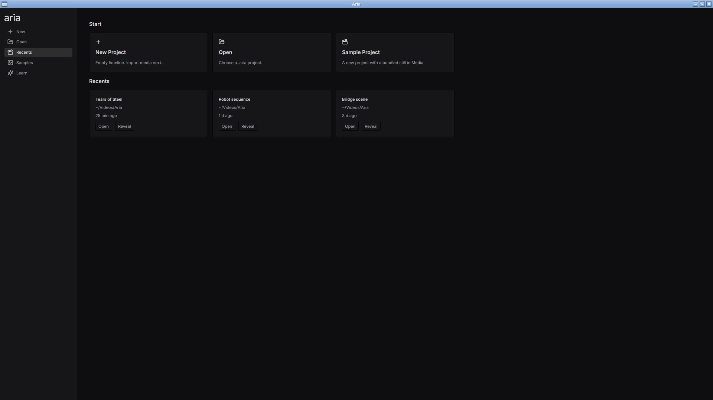
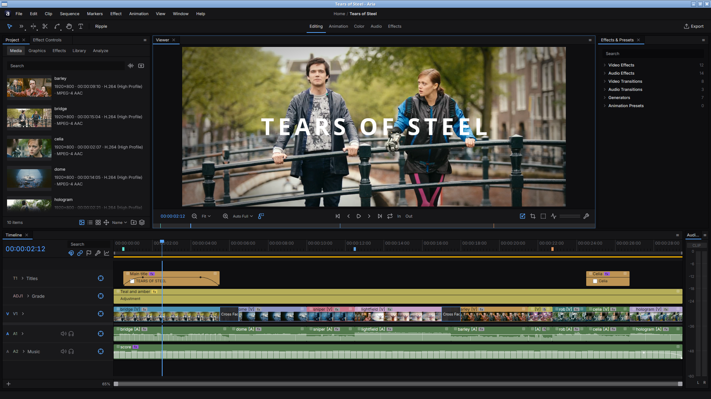

# Aria

Aria is a free, open-source video editor that cuts and animates in one
application. A multi-track timeline in the manner of Premiere Pro and the
layers, keyframes, masks, and graph editor of After Effects share one project
and one undo history. A cut, a title animation, and a composite stay in the
same sequence, with no second application and no round trip between them.

## Why Aria

- **One project for the edit and the motion work.** Keyframe every animatable property of
  a clip on the timeline where it was cut; nested sequences take the place of
  precomps.
- **Measured speed.** On the Server machine with software Vulkan
  ([measurements](docs/spec/status.md#performance-performancemd)), an edit or
  undo on a 10,000-clip project reaches the screen in 3.3 ms (p95), the
  timeline frame of that project builds in under 2.1 ms (p95), the project opens in
  46 ms, and the app starts in 0.75 s cold and 0.21 s warm.
- **Plugins on the same interfaces as the built-in features.** Effects,
  transitions, panels, commands, decoders, encoders, importers, and analyzers
  load from native (C ABI) or WebAssembly packages.
- **Scriptable.** A command line creates, inspects, analyzes, renders, and
  exports projects, and the optional assistant applies its changes as regular
  undoable commands.

The desktop UI is built on [santh-gpui](https://github.com/santhreal/santh-gpui).
The target editor is defined in the [specification](docs/spec/README.md).

Aria is in early alpha: the core editing loop works, and rough edges remain.
Project files include a schema version; a build opens every earlier version and
rejects a newer one without changing the file.

## What it looks like

| Home | Editor |
| --- | --- |
|  |  |

A clip bar is filled with its label color. UI text is Inter. The footage is
[Tears of Steel](https://mango.blender.org)
([CC BY 3.0](https://creativecommons.org/licenses/by/3.0/), Blender Foundation).

## What works today

- Import video, audio, and images onto a multi-lane timeline.
- Cut, trim, split, move, duplicate, ripple-delete, multi-select, markers, and
  a media bin with folders.
- Keyframes on every animatable property, with an easing curve per key.
- Transform, color grade, LUTs, masks, chroma key, track mattes, layer styles,
  adjustment layers, GPU effects, and transitions.
- Titles and shapes, with per-field text styling.
- Retiming: constant speed, reverse, and speed ramps, with the pitch either
  locked or riding the speed.
- Live preview with Space to play, and waveform, vectorscope, and histogram
  scopes.
- Audio analysis: beat grids on the clip, silence, loudness, and a measured
  duck under a flagged voice lane.
- Export to H.264 or H.265 MP4 with AAC audio.
- Optional assistant (configure a provider in Settings), a command-line
  interface, and plugins.

## Install

Download a build from the [releases page](https://github.com/santhreal/aria/releases),
or build from source with a recent stable Rust:

```bash
cargo run -p aria-desktop
```

Per-platform steps, codec support, and the GStreamer packages Linux needs are in
[docs/install.md](docs/install.md).

## Credits

- Aria is derived from [cutlass](https://github.com/1mrnewton/cutlass) by
  Emmanuel Aidoo and contributors, used under the MIT and Apache-2.0
  licenses. [`NOTICE`](NOTICE) lists every source and its license.
- Theme, popover, frost, and edge-fade are adapted from
  [Comet](https://github.com/zeronsh/comet) (MIT), as were the motion curves
  and loaders now in santh-gpui. License:
  [`LICENSES/comet-MIT.txt`](LICENSES/comet-MIT.txt).
- GPUI comes from [santh-gpui](https://github.com/santhreal/santh-gpui), a
  fork of the [Zed](https://github.com/zed-industries/zed) UI framework
  (Apache-2.0). License:
  [`LICENSES/zed-Apache-2.0.txt`](LICENSES/zed-Apache-2.0.txt).

## Docs

[Documentation index](docs/README.md) lists every document and the concern it covers.

- [Specification](docs/spec/README.md)
- [Install](docs/install.md)
- [Features](docs/features.md)
- [Getting started](docs/getting-started.md)
- [Keyboard shortcuts](docs/keyboard-shortcuts.md)
- [Command line](docs/command-line.md)
- [Plugin development](docs/plugins/README.md)
- [Architecture](docs/architecture.md)

## License

Dual-licensed under [Apache-2.0](LICENSE-APACHE) or [MIT](LICENSE-MIT), at
your option.
