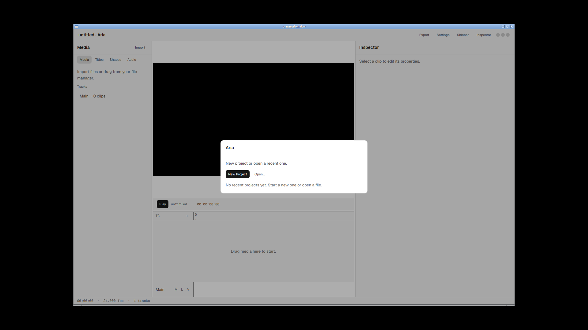
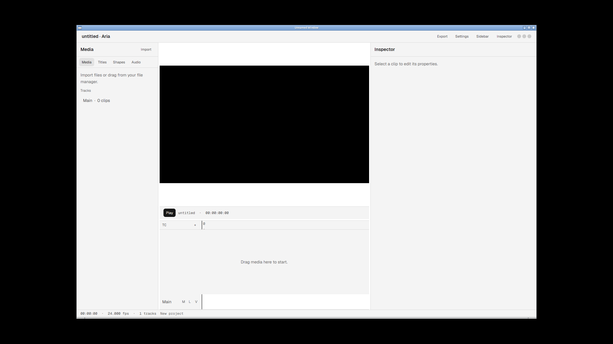

# Aria

Aria is a free, open-source video editor. Edit on a four-panel timeline, or
describe the change and the assistant applies it as regular undoable
commands.

The desktop UI is GPUI. Motion, theme, and loaders come from
[Comet](https://github.com/zeronsh/comet).

It's early alpha. The core editing loop works. Expect rough edges and a
project format that hasn't settled.

## What it looks like

| Home | Editor |
| --- | --- |
|  |  |

The chrome is monochrome: indigo playhead, amber snap guide, pink busy
spinner. Clip bodies stay neutral; track type is a 2 px left border.

## What works today

- Import video, audio, and images onto a multi-lane timeline.
- Cut, trim, split, move, duplicate, ripple-delete, multi-select, markers, and
  a media bin with folders.
- Keyframes on every animatable property, with an easing curve per key.
- Transform, colour grade, LUTs, masks, chroma key, track mattes, layer styles,
  adjustment layers, GPU effects, and transitions.
- Titles and shapes, with per-field text styling.
- Retiming: constant speed, reverse, and speed ramps, with the pitch either
  locked or riding the speed.
- Live preview with Space to play, and waveform, vectorscope, and histogram
  scopes.
- Audio analysis: beat grids on the clip, silence, loudness, and a measured
  duck under a flagged voice lane.
- Export to H.264 / AAC MP4.
- Optional assistant (configure a provider in Settings), a command-line
  interface, and plugins.

## Install

Download a build from the [releases page](https://github.com/santhreal/aria/releases),
or build from source with a recent stable Rust:

```bash
cargo run -p aria-desktop
```

Per-platform steps, codec support, and the GStreamer packages Linux needs are in
[docs/install.md](docs/install.md).

## Credits

- Aria is derived from [cutlass](https://github.com/1mrnewton/cutlass) by
  Emmanuel Aidoo and contributors, used under the MIT and Apache-2.0
  licenses. [`NOTICE`](NOTICE) lists every source and its license.
- Motion, theme, loaders, popover, frost, and edge-fade are adapted from
  [Comet](https://github.com/zeronsh/comet) (MIT). License:
  [`LICENSES/comet-MIT.txt`](LICENSES/comet-MIT.txt).
- GPUI comes from [santh-gpui](https://github.com/santhreal/santh-gpui), a
  fork of the [Zed](https://github.com/zed-industries/zed) UI framework
  (Apache-2.0). License:
  [`LICENSES/zed-Apache-2.0.txt`](LICENSES/zed-Apache-2.0.txt).

## Docs

[Documentation index](docs/README.md) lists every document and what it owns.

- [Install](docs/install.md)
- [Features](docs/features.md)
- [Getting started](docs/getting-started.md)
- [Keyboard shortcuts](docs/keyboard-shortcuts.md)
- [Command line](docs/command-line.md)
- [Plugin development](docs/plugin-development.md)
- [Architecture](docs/architecture.md)

## License

Dual-licensed under [Apache-2.0](LICENSE-APACHE) or [MIT](LICENSE-MIT), at
your option.
